# Hexa 3.0 — Renaissance

A music player for Android that hands your audio to the hardware instead of the mixer,
and stays out of your way while it does it.

**[Support, feedback and bug reports → Telegram](https://t.me/HexaPlayerSupport)**

---

## Screenshots

<table>
  <tr>
    <td align="center">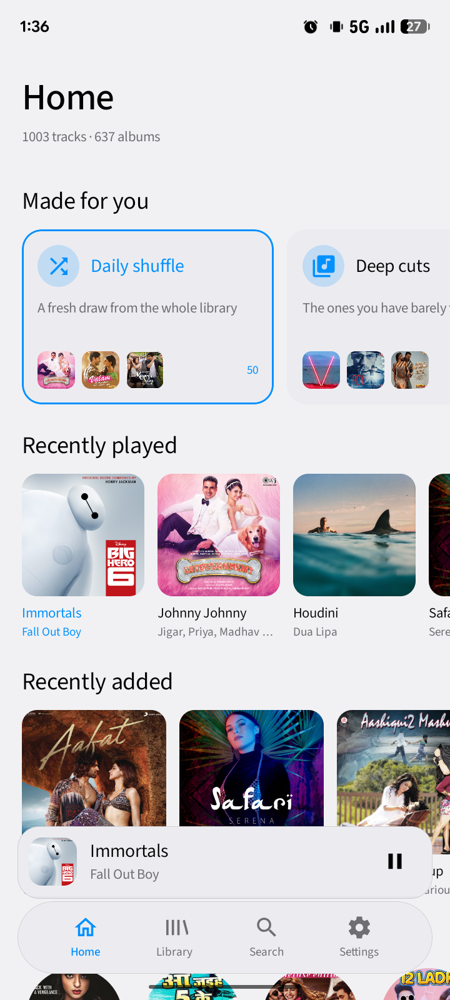 <b>Home</b> — made for you, daily</td>
    <td align="center">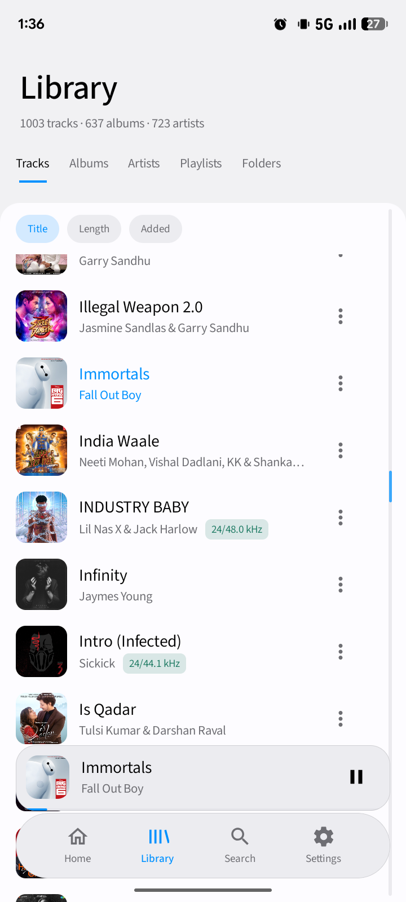 <b>Library</b> — every track, sortable</td>
    <td align="center">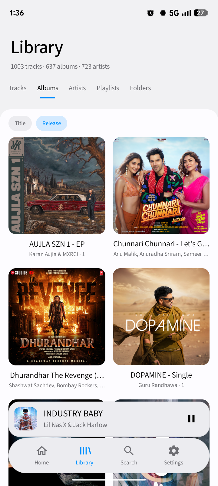 <b>Albums</b> — by release, or by title</td>
  </tr>
  <tr>
    <td align="center">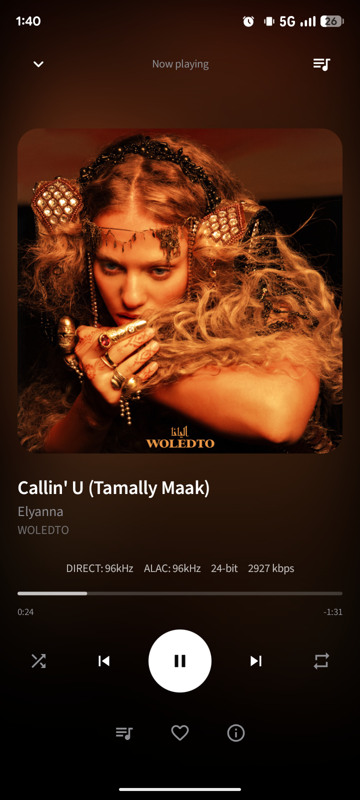 <b>Direct Path</b> — 96 kHz ALAC, 24-bit</td>
    <td align="center">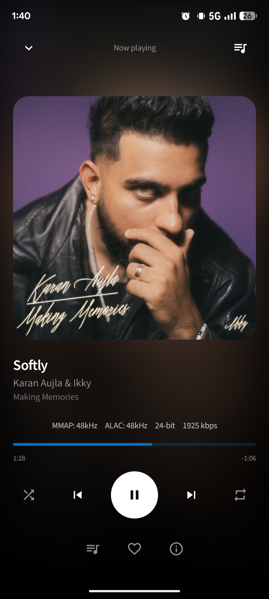 <b>MMAP Exclusive</b> — 48 kHz, 24-bit</td>
    <td align="center">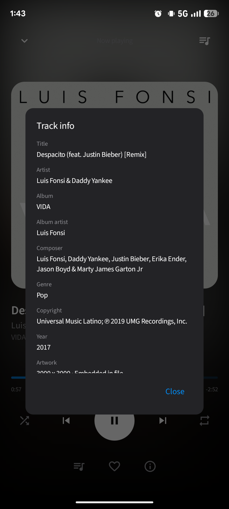 <b>Track info</b> — read from the file</td>
  </tr>
  <tr>
    <td align="center">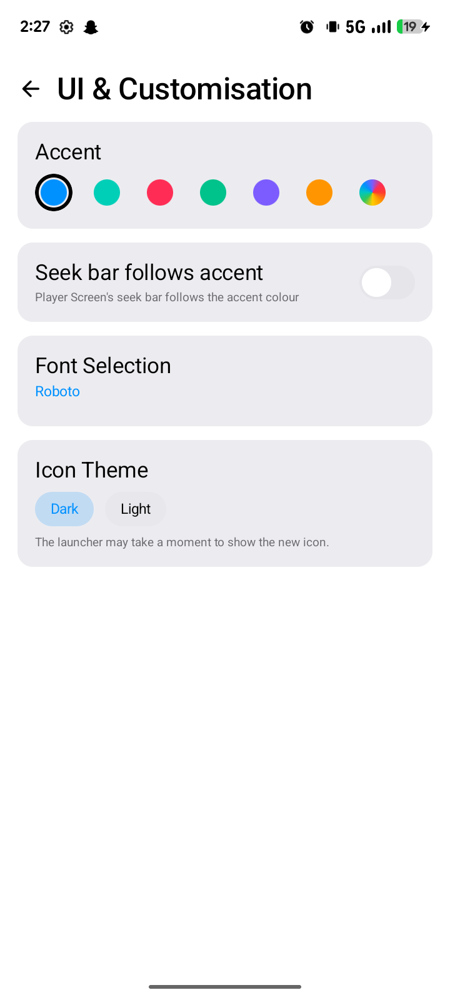 <b>UI &amp; Customisation</b> — accent, font, icon</td>
    <td align="center">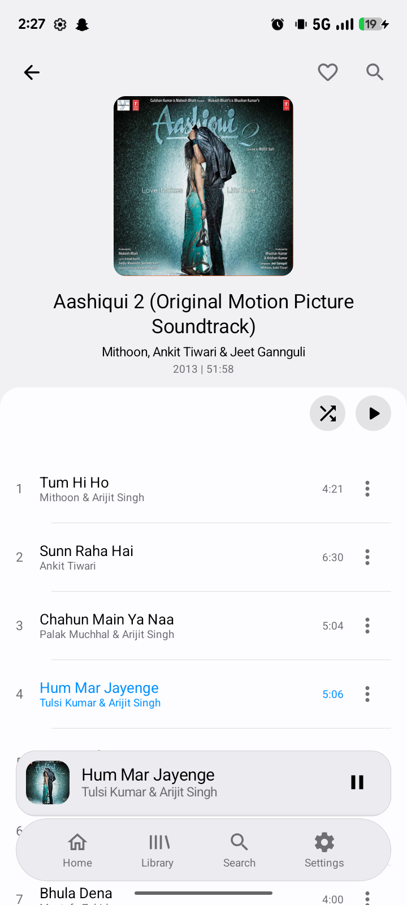 <b>Album</b> — cover, year, tracklist</td>
    <td align="center">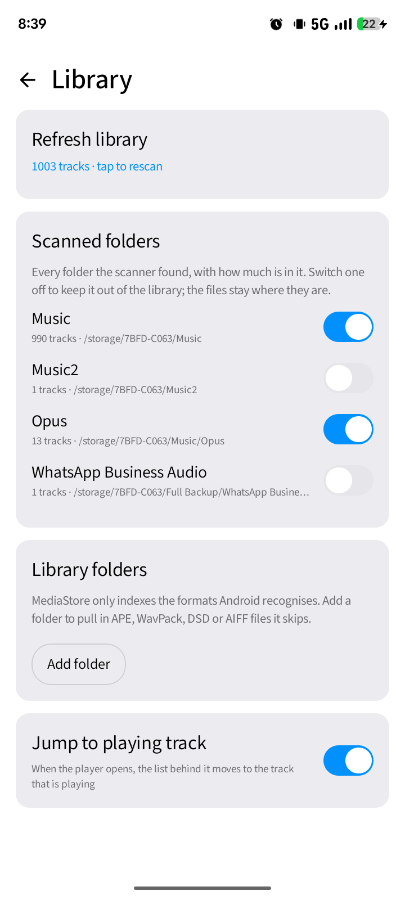 <b>Library</b> — folders, rescan, jump</td>
  </tr>
  <tr>
    <td align="center">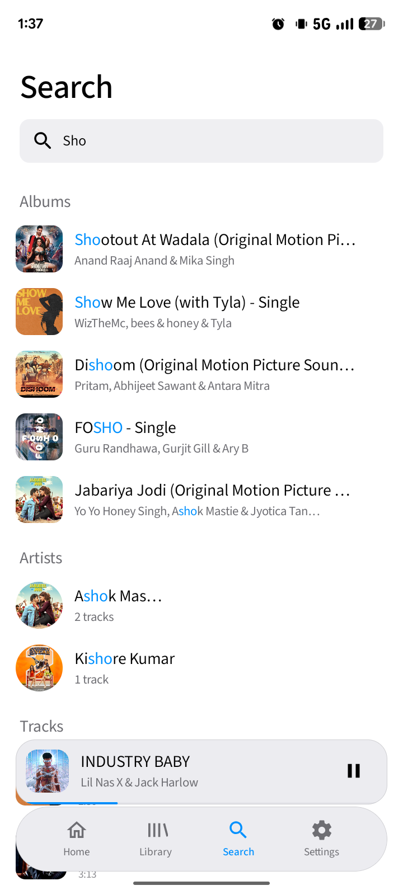 <b>Search</b> — matches highlighted</td>
    <td align="center">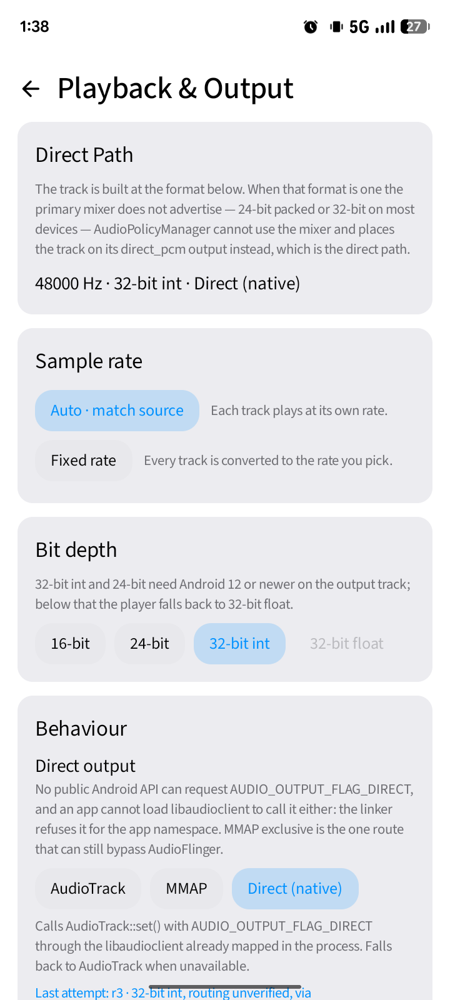 <b>Playback &amp; Output</b> — paths and depths</td>
    <td align="center">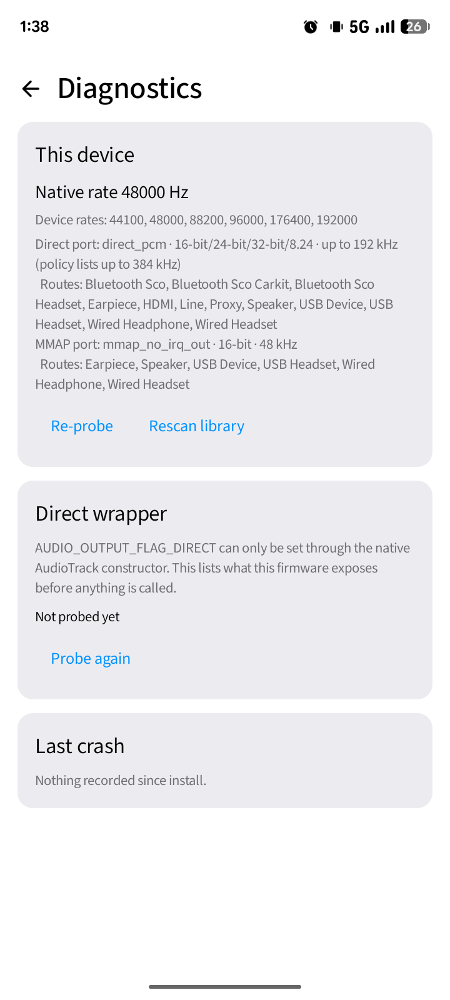 <b>Diagnostics</b> — what the device allows</td>
  </tr>
</table>

## High-resolution output, not high-resolution marketing

Most Android players hand your music to the system mixer, and the mixer resamples it to
whatever the phone happens to be doing at that moment. A 24-bit / 96 kHz file quietly comes
out at 48 kHz, and nothing on screen tells you it happened.

Hexa takes a different route. On supported devices it plays through a **Direct Path** or
**MMAP Exclusive** output that steps around the mixer entirely, so the file reaches the
hardware at its own rate and bit depth. No hidden resampling, no silent conversion to
whatever the system felt like today.

Plug in a USB DAC and the same untouched stream goes out to it — no mixer, no resampling
on the way (Requires capable Audio HAL).

That is the whole point of the app. Everything else exists so this part can work.

And when a phone doesn't allow it, Hexa says so. The player always reports the path, rate and
depth that were **actually used** for the track playing — not the ones that were requested.
If your phone caps direct output at 48 kHz, you will see 48 kHz and know it is the phone's
limit rather than guessing at the player's.

## A robust audio engine

The part you never see is the part that has to be right.

- **Four output paths, named for what they are** — DIRECT, MMAP, MIXER and SHARED — with the
  one in use shown on the player, per track
- **It steps down by itself.** If the chosen path cannot be opened, Hexa falls to the next one
  and updates the setting to match, so the screen never claims something the device refused.
  A choice you made by hand is never overridden — only a failure moves it
- **Rates the device really has.** The rate list is filtered to what the phone's own output
  port declares, and bit depth steps from 32-bit to 24 to 16 rather than dropping the format
  altogether
- **Match the source, or fix the rate.** Play each file at its own rate — the bit-perfect path
  — or pin one rate for everything
- **Its own decoder.** FFmpeg is built into the APK, so FLAC, ALAC, APE, WavPack, AIFF, DSD,
  Opus, AAC, MP3 and WMA all play, including the formats Android's scanner skips. Android's
  decoder is the fallback, and the player tells you which one is working
- **Tags read from the file**, not from a database someone else filled in — so an APE or DSF
  file shows its real title, artist and album

## A sleek, minimal interface

The interface is built to disappear. No chrome competing with the cover, no settings you have
to hunt for, nothing moving unless you moved it.

- **The cover, the whole cover.** Artwork is drawn at full size and never cropped, over a
  blurred wash taken from the artwork itself
- **Controls that look like controls.** A seek bar you can scrub, transport buttons that stay
  white, and one accent colour you choose — which can tint the seek bar if you want it to
- **Home that changes daily.** Daily shuffle, Deep cuts, Rediscover and Your rotation, built
  once a day, with what you played recently right below
- **A library that holds still.** Tracks, albums, artists, folders and playlists, each with
  its own sorting, a draggable scrollbar, and a search that highlights what matched
- **Folders Android ignores.** Point Hexa at a folder and it indexes what the system scanner
  skipped; hide a folder without forgetting it
- **Light and dark**, both designed rather than inverted
- **No account, no tracking, no internet.** The app does not request internet permission at
  all — it cannot send anything anywhere

## Install

1. Download the latest APK from [Releases](../../releases).
2. Open it. Android will ask permission to install from this source; allow it.
3. Play Protect may offer to scan the app, because it has not seen this one before.
   "Install without scanning" is fine.

Requires Android 8.0 or newer on a 64-bit device.

**Updating from an earlier build:** this release is signed with Hexa's own key, so a build
signed with a different key cannot be installed over it. If Android refuses the update,
uninstall the old app first. That is a one-time step.

## A note on what your phone allows

What Hexa can do depends on the phone, not on the app. Some devices allow Direct Path or MMAP
Exclusive output at high sample rates and bit depths; others cap it at 48 kHz, and some only
expose a path the system mixer resamples anyway. Hexa does not hide that — the player shows
exactly what happened for the track you are playing, and Diagnostics lists what the phone's
audio policy declares for each path.

## Feedback

Bugs, requests and "this sounds wrong on my phone" all belong in the
[Telegram group](https://t.me/HexaPlayerSupport). When reporting a playback problem, the
Diagnostics page is the most useful thing to include — it says which path was used and at
what rate.
